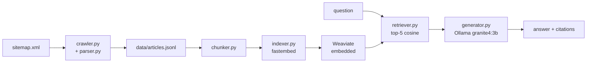

# faq-rag: naive RAG over the Dropbox Help Center

Ask a question about Dropbox in plain English and get an answer written from
the official [Dropbox Help Center](https://help.dropbox.com/), citing the
articles it came from. Everything runs locally and costs nothing: a polite
crawler, a local vector database (Weaviate), and a small open-source LLM
(`granite4:3b` through Ollama) that was chosen by benchmarking four candidates.

"Naive RAG" is deliberate: crawl → clean → chunk → embed → vector search →
put the top excerpts into a prompt → answer with citations. There's no agent
framework, no LangChain or LlamaIndex, no reranking and no query rewriting.
Each stage is a small, typed Python module you can read in one sitting.

| | |
| --- | --- |
| **Corpus** | 166 English articles (of about 1,195), split into 883 chunks, across 15 categories |
| **Search quality** | right article ranked first for 20 of 21 test questions (hit@1 0.95) and in the top 3 for all 21 (MRR 0.976) |
| **Answer quality** | `granite4:3b`, picked from four small models: states 81% of the expected key facts, cites the right article in 95% of its answers, declines 5 of the 6 questions it can't answer |
| **Cost** | $0: CPU only, no API keys |
| **Tests** | 78 unit tests, all offline |

## Contents

- [Quick start](#quick-start)
- [How it works](#how-it-works)
- [Evaluation: does search find the right article?](#evaluation-does-search-find-the-right-article)
- [Benchmark: which local model writes the best answers?](#benchmark-which-local-model-writes-the-best-answers)
- [Design decisions and trade-offs](#design-decisions-and-trade-offs)
- [Project layout](#project-layout)
- [Configuration](#configuration)
- [Tests](#tests)
- [Known limitations](#known-limitations)
- [Next steps](#next-steps)

## Quick start

Requirements: Linux or macOS, Python 3.11+, [uv](https://docs.astral.sh/uv/).

```bash
# 1. Install the Python dependencies
uv sync

# 2. Install Ollama (no sudo needed), start it, and download the model
curl -fsSL https://ollama.com/download/ollama-linux-amd64.tar.zst | tar --zstd -x -C ~/.local
rm -rf ~/.local/lib/ollama/cuda_*     # CPU-only machine: removes ~2 GB of NVIDIA runners
OLLAMA_CONTEXT_LENGTH=4096 OLLAMA_MAX_LOADED_MODELS=1 ollama serve &
ollama pull granite4:3b

# 3. Build the knowledge base
uv run faq-rag crawl                  # resumable: re-run it to continue (see "Crawl")
uv run faq-rag index

# 4. Ask
uv run faq-rag ask "How do I add a recovery email to my account?"
uv run faq-rag chat                   # a conversation with memory; type 'exit' to quit
```

A real run looks like this:

```text
$ uv run faq-rag ask "How do I delete my Dropbox account?"
Searching the help center...
Answering with granite4:3b - on a CPU it reads the excerpts for ~30-60 s before the first words appear...

To delete your Dropbox account, follow these steps:

1. Log in to dropbox.com.
2. Click your avatar (profile picture or initials) in the bottom-left corner.
3. Click ☑ (settings) in the top right.
4. At the bottom of the General tab, click Delete account. [1]
5. If you have an active subscription, you'll be prompted to cancel it in order to delete the account. [1]

Cited Excerpts:
[1] How to delete your Dropbox account (https://help.dropbox.com/account-access/delete-account)
How to delete your Dropbox account > Dropbox Basic, Plus, Professional, and Essentials

Sources:
  [1] How to delete your Dropbox account - https://help.dropbox.com/account-access/delete-account  (score=0.874)
  [2] How to delete your Dropbox account - https://help.dropbox.com/account-access/delete-account  (score=0.848)
  ...
```

The answer streams in word by word, and the "Sources" list is printed by
`faq-rag`. The "Cited Excerpts" block is the model's own addition, which
granite4 sometimes makes. On a CPU the first words take 30-60 s. In the run
above, which came right after the model loaded, granite4 spent about 44 s
reading 1,020 prompt tokens (~23 tokens/s), then wrote the answer at about
8 tokens per second.

### Commands

| Command | What it does |
| --- | --- |
| `crawl [--limit N] [--concurrency 3] [--delay 0.5]` | Sitemap → `data/articles.jsonl` |
| `index [--max-chars 1200] [--overlap-chars 200]` | Chunk and embed the articles into Weaviate (`data/weaviate/`) |
| `ask "question" [--top-k 5] [--retrieve-only]` | Answer one question. `--retrieve-only` shows the matching excerpts without calling the LLM |
| `chat [--top-k 5]` | Interactive conversation with memory |
| `eval` | Search-quality metrics on `eval/questions.jsonl` |
| `bench [--models a,b] [--limit N]` | Benchmark LLMs and write `eval/results.md` |

## How it works



### 1. Crawl (`crawler.py`)

- **Source.** The crawler reads the site's `sitemap.xml` (robots.txt allows
  it) instead of following links. It caches the 4.6 MB file in
  `data/sitemap.xml` so re-runs don't download it again.
- **Filtering.** The sitemap lists 16,967 URLs. 15,745 of them are
  translations: their first path segment is a locale such as `ja-jp` or
  `es-la` (18 locales, matched by `^[a-z]{2}-[a-z]{2}$`). Another 26 are
  category landing pages (one path segment, like `/billing`). That leaves
  **1,195 English articles**.
- **Politeness.** At most 3 requests at a time, a 0.5 s pause before each,
  and browser-like headers.
- **Retries.** A request that fails for an ordinary reason (an empty body,
  an unexpected status, a network error) is tried up to 5 times in total,
  pausing 1, 2, 4 and 8 s between attempts. HTTP 404 is a permanent skip; 3
  sitemap entries point at pages that no longer exist.
- **Bot protection.** When Dropbox answers with its bot challenge (the
  response header is `x-amzn-waf-action: challenge`), the crawl stops at
  once. Retrying a JavaScript challenge can't work, and it only adds requests
  that keep the block going. An earlier version retried each blocked page 5
  times until 10 pages had failed, about 50 wasted requests per block. Other
  kinds of failure still stop the crawl after 10 in a row.
- **Resumable.** Each article is appended to `data/articles.jsonl` as soon
  as it's parsed, together with the parser version that produced it.
- **Re-runs.** A re-run skips pages saved by the current parser. It re-fetches
  pages saved by an *older* parser first, then continues with pages never
  crawled. The file is append-only, and readers keep the newest record for
  each page, so improving the parser just means bumping `PARSER_VERSION` and
  re-running `crawl`.
- **Category interleaving.** URLs are fetched round-robin across the 16
  top-level categories rather than alphabetically, so even an interrupted
  crawl covers every category.

Dropbox's bot protection (an AWS WAF JavaScript challenge) has stopped every
crawl sooner or later:

- **First crawl:** 166 articles, then blocked.
- **After the table fix below:** all 166 were re-fetched so the fixed parser
  could re-parse them. It took five sessions, each saving 16 to 62 pages
  before the next block. The last three ran slowly (one request every ~6 s),
  15 minutes apart, and each stopped at the first challenge.

See [Known limitations](#known-limitations).

### 2. Parse (`parser.py`)

A pure function turns a page's HTML into an `Article` with url, title,
category, updated date and text. The selectors were checked by hand
against live pages:

- **Title:** `h1.hp01-header-updated-date__headline`.
- **Category:** the second breadcrumb item.
- **Updated date:** the "Updated Apr 09, 2024" text. Admin-only articles put
  an "Admins" badge in the same element, which gets stripped.
- **Body:** the `.responsivegrid` that is a direct child of the `.aem-Grid`
  containing the title. Each page also has an unrelated `.responsivegrid`
  elsewhere, so a plain class selector would pick the wrong element.
- **Removed:** the "Was this article helpful?" widget, related articles,
  community answers, scripts and SVG icons. Icons carry hidden titles that
  would otherwise leak text like "person icon" into the answers.
- **Kept as Markdown:** `##`/`###` headings, `-` bullets, `1.` numbered
  steps, and `**bold**` UI labels such as **Manage account**. Links become
  their text.
- **Tables** become one self-contained bullet per row, e.g. "User issue: I
  forgot my password; Possible solution: …reset your password…". That way a
  row still makes sense if the chunker splits a long table.
- **Text outside paragraphs.** Text sitting directly in a `<div>` or table
  cell is kept too. The first version dropped both tables and this text, and
  a user caught it: "I cannot login!" got "I don't know". Search had found
  the right article, "I can't log in to Dropbox", but 77% of that article
  lives in "issue → solution" tables, so the model received only the
  sentences leading into them. Across all 166 articles, the fix recovered
  5.4% more text. It was concentrated in a few pages: 31 articles gained
  more than 10%, and the largest gain was +353%.

### 3. Chunk (`chunker.py`)

- **Split points.** Each article is split on its `##`/`###` headings. Any
  section longer than 1,200 characters is split again, with about 200
  characters of overlap. Those splits happen only between paragraphs or list
  items, so a sentence is never cut in half.
- **Prefix.** Every chunk starts with `{title} > {section}`, so it makes
  sense on its own. Text before the first heading gets the section name
  "Overview".
- **Metadata:** `url`, `title`, `section`, `category`, and `chunk_id` in the
  form `{article-path}::{n}`.
- **Result:** 883 chunks, 5.3 per article, median 628 characters. Sizes
  range from 95 to 1,796 characters, because a single long paragraph is never
  cut.

### 4. Index (`indexer.py`)

- **Embeddings.** Chunks are embedded with `BAAI/bge-small-en-v1.5` through
  fastembed: 384 dimensions, ONNX runtime, no PyTorch. The vectors are
  normalized to unit length.
- **Storage.** The vectors go into **Weaviate 1.30 in embedded mode**, a
  local subprocess that the client starts itself, so there's no Docker and
  no server to run. We provide our own vectors, and Weaviate searches them
  with an HNSW index using cosine distance. Data lives in `data/weaviate/`.
- **Rebuilds.** Each `index` run drops and rebuilds the collection.
- **Sharing.** Only one process can run the embedded server. If another
  `faq-rag` command is already running it, for example an open `chat`,
  later commands connect to that server instead of failing.

### 5. Retrieve (`retriever.py`)

The question is embedded with the prefix bge models expect on queries
(`"Represent this sentence for searching relevant passages: "`), and
Weaviate returns the 5 nearest chunks. The score shown is 1 − cosine
distance, from 0 to 1.

### 6. Generate (`generator.py`)

The prompt has three parts:

- **System rules:** answer only from the excerpts; if they don't cover the
  question, say you don't know and point to Dropbox support; use numbered
  steps for procedures; after each fact, cite its excerpt, e.g. `[2]`.
- **Excerpts:** the 5 retrieved excerpts, numbered `[1]` to `[5]`, each
  with its article title and URL.
- **The question.**

It's sent through Ollama's OpenAI-compatible API with temperature 0 and a
512-token limit on the answer. The Ollama server runs with a 4,096-token
context. That covers the largest prompt (about 2,200 tokens) plus the answer,
and it matters: when a prompt is too long, Ollama silently drops its
*beginning*, which is where the rules are. In `ask` and `chat` the answer
streams as it's written.

### Chat memory

- **The LLM** sees the last 3 exchanges, capped so the prompt stays inside
  the 4,096-token context.
- **Search** also uses the previous question: it's prepended to the new one
  by plain string concatenation, not LLM query rewriting.

Giving only the LLM the history wasn't enough, and testing showed why.
"How do I delete my Dropbox account?" followed by "and what if I'm on the
Family plan?" searched for the second question alone. It found generic
Family-plan pages (score 0.62), and the model couldn't answer from excerpts
it never received. With the previous question prepended, search found the
Family section of the delete-account article (score 0.82), and the answer
gave the correct steps. The trade-off: after an abrupt change of topic, the
old topic still pulls on the next search.

## Evaluation: does search find the right article?

`uv run faq-rag eval` checks only the search step, with no LLM involved:
for each test question, does the right article come back?

### Test set

`eval/questions.jsonl` has **21 answerable questions**:

- **Phrasing:** written the way a user would ask, not copied from article
  titles.
- **Coverage:** the six areas the assignment asked for. Billing 4, plans 3,
  security 4, account access 5, sharing 3, installs 2.
- **Answers:** each question has the URL of the article that answers it,
  checked to exist in the crawl.

A few examples:

| Question | Article that answers it |
| --- | --- |
| I think someone hacked my Dropbox account, what should I do? | `security/account-hacked` |
| Sign in with Apple isn't working for my Dropbox account, how do I fix it? | `account-access/apple-sign-in-error` |
| How many devices can I use with one Dropbox account? | `account-access/computer-limit` |
| How do I add custom branding to my Dropbox shared links? | `share/branded-sharing` |

The file also has 6 questions the help center can't answer. The benchmark
uses them, and this search metric excludes them.

These questions exist only to **measure** the system. `ask` and `chat`
never read them; users can ask anything.

### Metrics

Both metrics count at the article level: any chunk from the expected
article is a hit.

- **hit@k:** the share of questions whose article appears in the top k results.
- **MRR** (mean reciprocal rank): the average of 1 / (position of the first
  correct result). 1.0 means the right article always came first.

### Search results

| Corpus | hit@1 | hit@3 | hit@5 | MRR |
| --- | --- | --- | --- | --- |
| First crawl (old parser) | 0.90 | 1.00 | 1.00 | 0.952 |
| **Current** (all 166 re-parsed) | **0.95** | **1.00** | **1.00** | **0.976** |

20 of 21 questions now get the right article first, and every one within
the top 3. Recovering the text the old parser dropped (article
introductions, tables) moved "why was my account disabled?" from second
place to first. The one remaining second place is a close neighbour: "turn
on two-factor authentication for **everyone on my team**" gets the article
on turning it on for your **own** account first.

These numbers are on the 166-article corpus. A full crawl adds many similar
articles (Dropbox has several cancellation articles, for example), so expect
the scores to drop somewhat once the corpus is complete.

## Benchmark: which local model writes the best answers?

Good search doesn't guarantee good answers, so `uv run faq-rag bench` scores
the **answers** of several local models on the same questions.

> **Three runs.** The results below come from **run 3**, the final
> comparison. Two earlier runs shaped its design and are kept for the record
> (see [Earlier runs](#earlier-runs)):
>
> | Run | Corpus | Models | Answers per question | Report |
> | --- | --- | --- | --- | --- |
> | 1 | first crawl | all four | 1 | [eval/results_first_crawl.md](eval/results_first_crawl.md) |
> | 2 | re-parsed | `llama3.2:3b` | 1 | [eval/results_llama_rerun.md](eval/results_llama_rerun.md) |
> | 3 | re-parsed | all four | 3, one per cache state | [eval/results.md](eval/results.md) |
>
> All three use the same prompt. Run 3's report rebuilds from its saved
> answers with `uv run faq-rag bench`. Runs 1 and 2 used one answer per
> question, which the current code no longer produces, so their reports are
> archived as they were.

### Constraints

- **Hardware:** a CPU-only laptop (Intel Meteor Lake, 14 threads, 30 GB RAM
  shared with a desktop session). No GPU is used.
- **Models:** local and small only. No paid APIs.
- **Scoring:** automatic checks only, with no "LLM as judge". A strong judge
  would need a paid API, and a small local judge is slow and unreliable.

### Candidates

This task rewards following instructions (use only these excerpts, cite
them, say "I don't know") more than general knowledge, and "thinking"
models only add CPU time. All four candidates are non-thinking models of
about 3 billion parameters, 4-bit quantized:

| Model | Maker | Size | Why it was included |
| --- | --- | --- | --- |
| `llama3.2:3b` | Meta | 2.0 GB (3.2B) | The standard small baseline |
| `qwen2.5:3b` | Alibaba | 1.9 GB (3.1B) | Strong at following strict output formats |
| `phi4-mini:3.8b` | Microsoft | 2.5 GB (3.8B) | Best reasoning in this size class |
| `granite4:3b` | IBM | 2.1 GB (3.4B) | Built for instruction following and enterprise RAG |

Left out:

- `gemma3:4b` and `qwen3.5:4b`: bigger (3.3-3.4 GB), and qwen3.5 is a
  thinking model.
- 1B-class models: the free "copy the top excerpt" baseline below serves as
  the floor instead.

### The test set, extended

The benchmark uses all 27 questions in `eval/questions.jsonl`. The 21
answerable ones get extra fields:

- **Key facts:** 2-4 short facts that a correct answer must state, taken
  from the question's excerpts. They're distinctive UI labels or figures
  (`Manage licenses`, `15 TB`, `Stop Using Apple ID`), never words that
  already appear in the question, so restating the question earns nothing.
  `a|b` accepts either wording. Where an article has branches, such as
  deletion steps that differ by plan, any branch's wording counts.
- **How-to flag:** 12 of the questions are marked as how-to, so their answer
  should be numbered steps.

The **6 unanswerable questions** are the part that separates models.
Off-topic questions are easy to decline. "Near-misses" sound like real
Dropbox questions, but the excerpts don't contain the answer:

| Question | Why it's a trap | Bait (a sign of an invented answer) |
| --- | --- | --- |
| What's the weather forecast for tomorrow? | off-topic | `°`, `degrees`, `sunny` |
| Can you write me a Python script that sorts a list of numbers? | off-topic | `def` followed by a space, `sorted(` |
| How much does a Dropbox Plus subscription cost? | the excerpts mention a 25% ASUS discount but no price | `$`, `€`, `per month`, `/year`, ... |
| What is the phone number for Dropbox customer support? | the excerpts mention a "backup phone number" for 2FA | `+1`, `800`, `888`, ... |
| How do I cancel my Dropbox Plus subscription? | the excerpts cover cancelling *Dash* and *deleting* an account | (none possible; checked by refusal) |
| Does Dropbox offer a student discount? | the excerpts are full of ASUS/Acer promotions | `.edu` |

The benchmark checks this dataset before every run. Every key fact must
appear in its question's excerpts, so a model is never asked for something
it wasn't given. No bait may appear in the excerpts or in the question
itself: "the excerpts don't mention a VPN" must not trip a `vpn` bait.

### Making the comparison fair

- **Frozen contexts.** Each question's top-5 excerpts were retrieved once
  and stored in `eval/contexts.jsonl`, so every model answers from exactly
  the same input. The file holds only chunk IDs and a short hash of each
  chunk, no Dropbox text. The text is rebuilt from the crawl, and a changed
  or missing chunk stops the run instead of silently changing the test.
- **Same settings.** Every model gets the production prompt, temperature 0,
  a 512-token answer limit and the 4,096-token context. Prompts that come
  close to the context limit are flagged; none did.
- **Three answers per question.** Even at temperature 0, an answer can
  depend on how much of the prompt Ollama has already cached (run 2 below
  found this). So each question is answered once in each cache state a real
  user meets:
  - *warm:* after a different question, so only the system prompt is cached;
  - *repeat:* the same question again, so the whole prompt is cached;
  - *cold:* the first question after the model loads, so nothing is cached.
    Ollama unloads a model after 5 idle minutes, so an occasional user
    meets this state most often.

  `bench` sets up each state just before the timed answer, reloading the
  model for *cold*. The server log confirmed the states: warm answers reused
  about 155 cached tokens, repeats all but one, and cold answers none.
- **Timing.** One model is loaded at a time, and loading is never timed.
  The reported time is for warm answers.
- **Provenance.** The report records the Ollama version (0.34.4) and each
  model's digest and quantization.

### What counts as a good answer

Each answer goes through checks in `scoring.py`. They're pure functions, so
each one is unit-tested:

| Check | How it works |
| --- | --- |
| **Answer score** | Share of the question's key facts stated in the first 200 words; 0 if the model refused. The 200-word window stops long answers from padding their way to a high score. Citation numbers are stripped first, so `[3]` doesn't count as the fact "3 devices". |
| **Cites correctly** | At least one inline citation points to an excerpt from the right article, and no citation points to an excerpt that doesn't exist. Accepts `[1]`, `[1][2]`, `[1, 2]`, `[1-3]` and `[Excerpt 1]`. A bracket number at the start of a line is a list marker or a reference list, not a citation. |
| **Refusal** | An answer counts as *abstained* only if it opens with a first-person "I don't know" or a statement about the excerpts ("…is not stated in the provided excerpts"), and is short with no list. Help articles themselves say things like "if you can't find it, contact support", so a correct answer that repeats that isn't a refusal. |
| **Declines** | On an unanswerable question: the answer opens with a refusal and contains no bait. |
| **Steps** | On a how-to question: the answer contains a numbered list. |

### Picking a winner

- **The per-model number** is the mean answer score: each question's score
  is averaged over its three answers, then over questions. The 95%
  confidence interval comes from resampling the questions 2,000 times. With
  21 questions, intervals are about ±0.13, which is useful for being honest
  about ties.
- **Two gates.** A model is recommended only if it cites correctly in at
  least 90% of its answers to answerable questions **and** declines in at
  least 80% of its answers to unanswerable ones (15 of 18). A support bot
  that can't show its sources, or that invents answers, isn't usable however
  fluent it is.
- **The winner** is the model with the highest answer score among those that
  pass. If another passing model's interval overlaps and it's at least 25%
  faster, it wins instead.
- **Two free baselines** anchor the scale. *Always refuse* shows that
  declining alone isn't enough. *Copy excerpt [1]* pastes the first 200
  words of the top excerpt; a model has to beat it to be worth its latency.

### Results (run 3)

| Model | Answer score (95% CI) | Cites correctly | Declines | Unstable questions | Median time (warm) | Gates |
| --- | --- | --- | --- | --- | --- | --- |
| **`granite4:3b`** | **0.81 (0.68-0.94)** | **95%** | **15/18** | **6/27** | **68 s** | **pass** |
| `llama3.2:3b` | 0.79 (0.63-0.93) | 90% | 15/18 | 2/27 | 54 s | pass |
| `qwen2.5:3b` | 0.84 (0.72-0.95) | 22% | 15/18 | 13/27 | 55 s | fail |
| `phi4-mini:3.8b` | 0.84 (0.73-0.94) | 67% | 13/18 | 8/27 | 80 s | fail |
| *baseline: copy excerpt [1]* | 0.73 (0.58-0.86) | 95% | 0/18 | - | - | - |
| *baseline: always refuse* | 0.00 | 0% | 18/18 | - | - | - |

The counts cover all three answers per question: 63 answers to answerable
questions and 18 to unanswerable ones. A question is *unstable* when its
three answers get different verdicts; the time is for warm answers. The full report, with refusals,
hedges, steps and cut-off answers, is [eval/results.md](eval/results.md).

**Winner: `granite4:3b`**, now the default model. Two models pass both
gates, and on answers they're statistically tied: the intervals overlap
almost entirely. llama3.2 is 20% faster, short of the 25% the rules require
before speed can break a tie, so granite's higher score decides it. In
practice, the two differ like this:

- **granite4** cites more reliably (95% of answers against 90%) and never
  refused an answerable question.
- **llama3.2** is faster (54 s against 68 s warm, 59 s against 72 s cold)
  and steadier (2 unstable questions against 6). But in every cache state it
  refused one answerable question ("I don't know [1]" on sharing
  restrictions) and answered "What is Dropbox Advanced?" with just `[1]`.

So `LLM_MODEL=llama3.2:3b` is a reasonable choice if speed matters more.

**A scorer fix decided the winner, so here it is in full.** Reading every
flagged answer found three correct granite declines that the refusal
patterns missed:

- "I'm sorry, but I don't have the capability to write a Python script…"
- "The excerpts provided do not contain information about a student
  discount…"
- "The information provided does not pertain to a student discount…"

The patterns were widened for these phrasings, with a guard so product text
like "your billing information doesn't include…" still isn't a refusal. The
new cases became tests. The fix applies to every model, but it changes
only granite's count, from 12 to 15 of 18, which turns its decline gate from
fail to pass. Without it, llama3.2 would have won. Re-scoring runs 1 and 2
with the fixed patterns changes nothing there.

What run 3 showed:

- **Answers change more than verdicts.** Depending on the model, only 3 to
  14 of the 27 questions got the same text in all three cache states, but
  only 2 to 13 got a different verdict. No state is clearly better or
  worse: cold answers scored lowest for three models and highest for qwen,
  and the gaps are at most 0.06.
- **qwen2.5 still can't be verified.** It starts lines with bracket labels,
  so only 22% of its answers pass the citation check. Even counting labels
  like a repeated `[4]` as citations, it reaches 71%.
- **phi4-mini used outside knowledge.** After declining the Python
  question, two of its answers suggested `sorted()` anyway, which the prompt
  forbids. Three of its answers also ran into the 512-token limit.
- **Cancel still means delete.** All four models, in every cache state,
  present deleting the account as the way to cancel Dropbox Plus: 12 answers
  out of 12.
- **granite4 came last in run 1 and wins run 3.** In run 1 it answered the
  student-discount question with an ASUS promotion. On the re-parsed corpus
  it declines that question in every cache state, and it cites the most
  reliably of the four.

Where `granite4:3b` lost points (from reading its answers):

- **Too short:** "Can I use Dropbox on my phone?" got "Yes, you can use
  Dropbox on your phone. [2]" and nothing more, in every cache state.
- **Wrong case:** on "I lost access to my email **and forgot my password**",
  it gave the steps for users who still know their password, as llama3.2
  does.
- **Incomplete:** "Why was my account disabled?" lists the reasons but
  leaves out contacting your admin and requesting a review.
- **Unstable:** the hacked-account question got all four key facts when
  cold, three when warm, and one when repeated.

### A prompt fix, tested and rejected

Run 1 suggested one change to the prompt: tell the model to number steps
`1.`, `2.`, `3.` and to use square brackets only for citations. It targeted
qwen2.5 numbering its steps `[1] [2] [3]` and llama3.2 pasting a `[1]`-`[5]`
list. It was tested before run 3:

1. **As the prompt's last sentence** ("Use square brackets only for
   citations - never as step numbers or list labels"), it failed a
   2-question smoke test: llama3.2 cited in none of its 6 answers. Both
   questions had cited under the current prompt. Small models tend to
   over-apply a "never" instruction.
2. **Reworded** to fold the rule into the steps sentence ("…written as 1.,
   2., 3. (square brackets like [2] are reserved for citations)"), it was
   screened on 10 held-out questions. No benchmark question uses their
   articles, so the benchmark never tuned the prompt. Each got one answer,
   in the warm cache state. The decision rule was fixed before the screen
   ran: the prompt with more citing answers wins.

| Model | Prompt | Answers with an inline citation | `[n]` used as a line label | Numbered steps |
| --- | --- | --- | --- | --- |
| `llama3.2:3b` | current | **7/10** | 0/10 | 10/10 |
| `llama3.2:3b` | with the rule | 5/10 | 1/10 | 10/10 |
| `qwen2.5:3b` | current | **6/10** | 9/10 | 2/10 |
| `qwen2.5:3b` | with the rule | 3/10 | 2/10 | 10/10 |

The rule does fix the format it targets: qwen's bracket step labels drop
from 9 answers in 10 to 2. But both models cite less: 13 of 20 answers fell
to 8, and citing is a gate. So the prompt stayed as it was, and run 3 uses
it unchanged.

### Earlier runs

Runs 1 and 2 used the same prompt and questions as run 3, but one answer
per question.

#### Run 1: four models on the first crawl

| Model | Answer score (95% CI) | Cites correctly | Declines | Steps | Median time | Gates |
| --- | --- | --- | --- | --- | --- | --- |
| **`llama3.2:3b`** | **0.84 (0.70-0.97)** | **90%** | **5/6** | **12/12** | **48 s** | **pass** |
| `qwen2.5:3b` | 0.86 (0.73-0.95) | 33% | 5/6 | 6/12 | 48 s | fail |
| `phi4-mini:3.8b` | 0.83 (0.68-0.94) | 62% | 5/6 | 12/12 | 64 s | fail |
| `granite4:3b` | 0.77 (0.63-0.91) | 90% | 4/6 | 12/12 | 63 s | fail |
| *baseline: copy excerpt [1]* | 0.73 (0.56-0.87) | 90% | 0/6 | 8/12 | - | - |
| *baseline: always refuse* | 0.00 | 0% | 6/6 | 0/12 | - | - |

**Winner: `llama3.2:3b`.** It was the only candidate that both cited its
sources and declined when it should. Its answer score was statistically tied
with the best, and it was joint-fastest.

The margin was thin, though. It passed the citation gate by exactly one
question, and all four models' answer-score intervals overlapped, so on
content alone they were indistinguishable at this sample size. Behaviour
decided it.

Where `llama3.2:3b` lost points (from reading its answers; all four recur in
[run 2](#run-2-the-winner-alone-on-the-re-parsed-corpus)):

- **False refusal:** "Why has my sharing activity on Dropbox been
  restricted?" got "I don't know [1]", although its excerpts list the
  reasons.
- **Empty answer:** "What is Dropbox Advanced?" got just `[1]`.
- **Wrong case:** on "I lost access to my email **and forgot my password**",
  it quoted the case for users who *know* their password.
- **Cancelling Plus:** it gave account-deletion steps, like every other model.

What run 1 revealed:

- **`qwen2.5:3b` writes the most complete answers, but they can't be
  verified.** It numbers steps `[1] [2] [3]` instead of `1. 2. 3.`, and once
  wrote `[6]` when only 5 excerpts existed. Its brackets are list markers,
  so you can't tell which source a sentence came from. It also padded a
  currency answer with a step borrowed from a Dropbox *Sign* excerpt ("Navigate
  to the Billing tab near the top of the screen"), which doesn't apply.
- **`granite4:3b` was my favourite before the benchmark, and it came last.**
  The first draft of the prompt said "cite using [n]", and granite wrote a
  literal `[n]`. The prompt now gives a concrete example, `[2]`. Granite also
  answered two near-misses instead of declining. That's why models get
  benchmarked rather than picked on reputation.
- **Every model fails the same question dangerously.** Asked "How do I
  cancel my Dropbox Plus subscription?", all four present *deleting the
  account* as the way to cancel. The crawl has no cancellation article yet,
  and the delete-account excerpt mentions cancelling a subscription in
  passing. For a support bot, this is the most harmful failure found.
- **Copying the top excerpt already scores 0.73.** The models add 0.04-0.13
  by combining excerpts. Their bigger value is declining: the copy baseline
  "answers" all 6 unanswerable questions.

#### Run 2: the winner alone on the re-parsed corpus

The parser fix changed the excerpts, so the contexts were frozen again and
the winner was benchmarked again. The other three models weren't re-run;
they had been removed to free disk space.

| Run | Answer score (95% CI) | Cites correctly | Declines | Steps | Median time | Gates |
| --- | --- | --- | --- | --- | --- | --- |
| First crawl | 0.84 (0.70-0.97) | 90% (19/21) | 5/6 | 12/12 | 48 s | pass |
| Re-parsed corpus | 0.77 (0.62-0.92) | 86% (18/21) | 5/6 | 12/12 | 51 s | fail |

The copy-excerpt baseline scores 0.73 on both corpora.

On paper, `llama3.2:3b` now misses the citation gate by one question.
Comparing the runs answer by answer shows why. 24 of the 27 prompts
changed. Half of them got new or reordered excerpts. The other half kept
the same excerpts with small edits, often a single space restored after
bold text. 23 of the 27 questions still scored the same, and three got
worse:

- **"I think someone hacked my Dropbox account"**, the answer that drops it
  below the gate. Instead of answering, the model pasted the first sentence of
  each excerpt as a list labelled `[1]` to `[5]`. Brackets at the start of a
  line are list labels to the scorer, not citations, so the answer cites
  nothing. It states 1 of the 4 key facts.
- **"How do I add more storage or licenses?"** It gave the steps for
  *viewing* license usage on the admin Dashboard, not for buying more under
  **Billing** → **Manage licenses** (1 of 3 facts).
- **"Why was my account disabled?"** It opened with "I don't know why your
  Dropbox account was disabled", then listed the reasons correctly, but
  left out that you can request a review (2 of 3 facts).

One got better: "How many devices can I use?" went from 2 of 3 facts to 3
of 3.

**The same prompt doesn't always get the same answer.** The hacked-account
prompt differs from the first run's by a single space:
`**Sign in as user**feature` became `**Sign in as user** feature`. To test
whether that space caused the new answer, both versions were sent to the
model again, twice each:

| Prompt version | Answers seen |
| --- | --- |
| First crawl | 3 different answers in 3 tries: the first run's good answer, the same pasted list that fails, and a third with inline citations |
| Re-parsed | the pasted list, 3 times out of 3 |

So even at temperature 0, this answer isn't stable on this setup, and the
first run's pass on it was partly luck. The server log shows the cause. The
three tries of the first-crawl prompt had different amounts of it already
cached:

- about 138 tokens (the system prompt, left by the previous question);
- none (the model had just loaded);
- 699 of 700 (the same prompt again).

A cached prefix changes how the rest of the prompt is batched, so the
arithmetic differs slightly, and a near-tie between two tokens can go
either way.

So neither gate verdict meant much on its own: the two answer-score
intervals overlap almost entirely, and both runs were one answer from the
citation line. Run 3 was designed around this. It answers every question
in all three cache states and compares all four models again on the same
corpus.

### How the benchmark itself was checked

Automatic checks can be wrong, so every questionable verdict was read by
hand, and each scorer bug became a regression test:

1. **A 3-question smoke test** caught granite's literal `[n]`, which led to
   the prompt fix. It also caught qwen's `[1]` list markers being counted as
   citations, which led to the line-start rule.
2. **Reading every decline and refusal** of all four models found correct
   declines the scorer had missed, such as "…is not explicitly stated in the
   provided excerpts" and "I'm sorry, but I don't have the information you
   requested". The refusal patterns were widened for them, and false
   positives on ordinary text were guarded against. Run 3 needed this once
   more: three granite declines (see [Results](#results-run-3)).
3. **All 52 scoring tests** use real phrasings the models produced.
4. **Answers are cached**, keyed by a hash of the model, the exact prompt
   and the cache state, in `data/bench/answers/`. So after each scorer fix,
   `bench` re-scores all saved answers in seconds, with no regeneration.
   Generating run 3's 324 answers took about 4.5 hours on this CPU.
5. **Repeating a prompt** (run 2) showed that the same input can get a
   different answer, depending on the prompt cache. Run 3 answers every
   question in all three cache states, and the server log confirmed each
   state before the run.
6. **A smoke test before run 3** caught the prompt rule that stopped
   llama3.2 citing, before 4 hours of CPU were spent on it.

### Limitations of the benchmark

- **Small sample.** 21 answerable questions only separate large differences.
- **Facts, not faithfulness.** The answer score checks that facts are
  present, not that the answer is faithful. Correct facts padded with steps
  from the wrong article aren't penalised. The runner-up does this: in runs
  1 and 2, llama3.2's billing-currency answer starts with four steps from a
  Dropbox *Sign* excerpt that don't apply to a Dropbox subscription.
- **Timing.** In run 1 the machine was swapping heavily during the first
  models' runs, so those models ran under more memory pressure. Run 3 had
  memory to spare, and the speed order held: llama3.2 and qwen2.5 fastest,
  phi4-mini slowest. Speed didn't decide either winner.
- **Repeatability.** Even at temperature 0, the same prompt can get a
  different answer, depending on what Ollama has cached. Run 3 covers the
  three cache states a user meets, but not every possible cached prefix. In
  a chat, for example, the history changes what's cached again.
- **One prompt for all.** Every model gets the same generic prompt. Granite,
  for example, has its own RAG format that wasn't used.

## Design decisions and trade-offs

**Weaviate instead of a plain numpy array.**

- *History:* the first version searched a normalized numpy array by brute
  force, which is plenty fast for 862 vectors. It moved to Weaviate so the
  project uses a real vector database. After the switch, the eval metrics and
  the similarity scores I spot-checked came out identical, as expected: HNSW
  is effectively exact at this size.
- *Why embedded:* embedded mode keeps setup to `uv sync`.
- *Trade-offs:* embedded Weaviate is Linux/macOS only and labelled
  "Experimental", and only one process can run the server. A deployment
  would run Weaviate as a proper service.

**A local model instead of a cloud API.** Running on Ollama makes the
project free and private: nothing leaves the machine. The costs are speed
(30-60 s before the first words on a CPU) and less reliable instruction
following, which is why the benchmark exists. `generator.py` works with any
OpenAI-compatible server, so pointing `.env` somewhere else needs no code
changes.

**Heading-based chunking instead of fixed-size windows.** Help articles are
already written as focused sections, so splitting on headings keeps each
chunk about one thing. The title and section prefix makes each chunk
self-explanatory. The cost is uneven chunk sizes (95 to 1,792 characters).

**`bge-small-en-v1.5` for embeddings.** It's small (384 dimensions), runs on
CPU with no PyTorch, and is strong for its size on retrieval benchmarks.
English-only is fine, because the crawler keeps only English pages.

**No Dropbox text in git.** Crawled data (`data/`) is git-ignored. The
benchmark's frozen contexts are stored as chunk IDs and hashes, not text.

**No bot-protection evasion.** When Dropbox's bot protection kicks in, the
crawler stops and waits. It doesn't try to solve the JavaScript challenge
(for example with a headless browser), because that would turn a polite
crawler into a detection-evasion tool.

## Project layout

```text
├── src/faq_rag/
│   ├── crawler.py      # sitemap → filtered, interleaved URLs → articles.jsonl (retries, circuit breaker, resume)
│   ├── parser.py       # page HTML → clean Article (pure function)
│   ├── chunker.py      # Article → heading/size chunks with "{title} > {section}" prefix
│   ├── indexer.py      # chunks → fastembed vectors → embedded Weaviate
│   ├── retriever.py    # question → top-k chunks with similarity scores
│   ├── generator.py    # prompt building, Ollama calls, streaming
│   ├── evaluator.py    # search metrics: hit@k, MRR
│   ├── scoring.py      # answer checks for the benchmark (pure functions)
│   ├── benchmark.py    # frozen contexts, generation cache, baselines, CIs, report
│   └── cli.py          # crawl, index, ask, chat, eval, bench
├── eval/
│   ├── questions.jsonl            # 27 test questions with expected articles, key facts, bait
│   ├── contexts.jsonl             # frozen top-5 chunk IDs per question (no Dropbox text)
│   ├── results.md                 # benchmark report, run 3: four models, current corpus
│   ├── results_first_crawl.md     # archived run 1: four models, first crawl
│   ├── results_llama_rerun.md     # archived run 2: llama3.2:3b alone, current corpus
│   ├── contexts_first_crawl.jsonl # frozen chunk IDs for run 1
│   └── evaluate.py                # same as `faq-rag eval`, as a plain script
├── tests/                         # parser, chunker, crawler, indexer, scoring and benchmark tests
└── data/                          # git-ignored: sitemap cache, articles, Weaviate index,
                                   # cached benchmark answers, the first crawl (data/v1/)
```

## Configuration

Everything works with the defaults. `.env` (see `.env.example`) can change:

| Variable | Default | Purpose |
| --- | --- | --- |
| `LLM_MODEL` | `granite4:3b` | Model used by `ask` and `chat`. `llama3.2:3b` is the faster runner-up |
| `OPENAI_BASE_URL` | `http://localhost:11434/v1` | Any OpenAI-compatible server |
| `OPENAI_API_KEY` | `ollama` (placeholder) | Only if that server needs a real key |

Start the Ollama server with `OLLAMA_CONTEXT_LENGTH=4096`, which leaves room
for the prompt and the answer, and `OLLAMA_MAX_LOADED_MODELS=1`, which keeps
memory use to one model.

## Tests

```bash
uv run pytest     # 78 tests, no network or LLM needed
```

- **Parser (12):** title, category and date extraction; Markdown structure;
  removal of widgets and icons; picking the right body element; spacing
  around bold text; tables with and without headers; text outside
  paragraphs; HTML comments; the parser version stamp.
- **Chunker (5):** heading splits; size splits with overlap; whole units
  only; unique chunk IDs.
- **Crawler (5):** outdated pages are re-fetched before new ones;
  unversioned records count as version 1; a bot challenge costs one request
  (no retries); 404s aren't retried. These use a fake HTTP server, so no
  network is needed.
- **Indexer (1):** when a page was re-crawled, the newest record wins.
- **Scoring (52):** citation formats, refusal and hedge detection, key-fact
  matching, bait, and the steps check, pinned to real model outputs.
- **Benchmark (3):** scores are pooled over each question's three answers;
  a question counts as unstable only when its answers get different
  verdicts; each cache state has its own cache key.

## Known limitations

- **Only 14% of the help center is crawled.**
  - *Why:* help.dropbox.com is behind an AWS WAF bot challenge (the response
    header is `x-amzn-waf-action: challenge`). Once it starts, a plain HTTP
    client can't get through; only time helps.
  - *What happened:*
    - The first crawl reached 166 articles, then stayed blocked through 20
      retries over about 80 minutes.
    - Later sessions got through 16-62 pages each before the next challenge.
    - Waiting about 15 minutes, and spending only one request per blocked
      session, was enough to get through again.
  - *To continue:* re-run `uv run faq-rag crawl` later (a slow pace such as
    `--concurrency 1 --delay 5` worked), then `uv run faq-rag index`.
  - *Impact:* until then, whole topics are missing. Cancelling a
    subscription is the notable one.
- **Reproducing the exact numbers needs the same articles.**
  - `data/` isn't committed, and a fresh crawl may stop on a different set
    of articles.
  - `eval` then measures a different corpus.
  - `bench` refuses to run if a frozen chunk is missing or has changed,
    instead of quietly testing something else.
  - The saved answers and the two reports in `eval/` are the record of the
    runs described here.
- **Small local models follow instructions imperfectly.** Even the winner
  sometimes answers too briefly or picks the wrong case, and every model
  tested misreads "cancel" as "delete account" (see the benchmark). The same
  question can also get a different answer depending on what Ollama has
  cached.
- **Speed.** On a CPU, answers take 30-60 s to start.
- **Embedded Weaviate** runs only on Linux and macOS. Windows would need
  Docker or Weaviate Cloud, which means a small change to `connect()` in
  `indexer.py`.
- **By design, for a naive baseline:** no reranking, no hybrid search and no
  LLM query rewriting. Chunk sizes are uneven.

## Next steps

1. **Finish the crawl** and re-index, then re-run `eval`. For `bench`,
   re-freeze the contexts by deleting `eval/contexts.jsonl`, and re-check
   the key facts. The pattern that worked for the re-parse was slow sessions
   (`--concurrency 1 --delay 5`) about 15 minutes apart, each stopping at the
   first challenge. At about 30 pages per session, the remaining ~1,030
   articles would take roughly 35 sessions.
2. **Fix the cancel-means-delete failure:** crawl the cancellation articles,
   and consider a prompt rule for excerpts that describe a *different*
   action than the one asked about.
3. **A citation rule that doesn't cost citations.** The bracket rule fixed
   qwen's `[1] [2] [3]` step labels, but both models cited less (see
   [A prompt fix, tested and rejected](#a-prompt-fix-tested-and-rejected)).
   A worked example of a cited answer in the prompt might fix both. It
   would need the same held-out screen before a benchmark run.
4. **More test questions.** 21 answerable questions can't separate granite4
   (0.81) from llama3.2 (0.79): each interval is about ±0.13 wide, so a
   0.02 gap is noise. Four times as many questions (about 85) would halve
   the interval width.
5. **Better retrieval:** hybrid BM25 + vector search (helps exact UI terms
   and error codes), cross-encoder reranking, and LLM query rewriting for
   chat follow-ups.
6. **A faithfulness check,** claim by claim, so padded or misapplied content
   is caught.
7. **Incremental re-crawls:** compare each article's stored "Updated" date,
   or the sitemap's `<lastmod>` (which the crawler doesn't read yet), to
   fetch only articles that changed.
8. **Try the laptop's Intel GPU.** Ollama detects the Meteor Lake GPU but
   leaves it off. Setting `OLLAMA_IGPU_ENABLE=1` might cut the 30-60 s it
   spends reading excerpts. This is untested.
